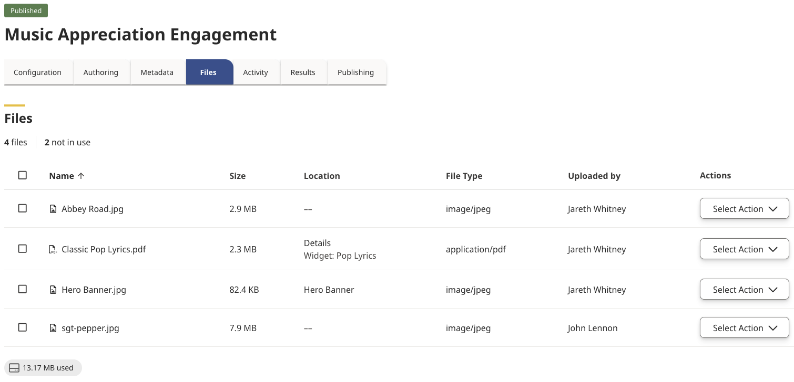
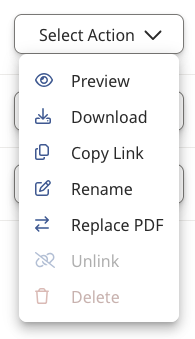
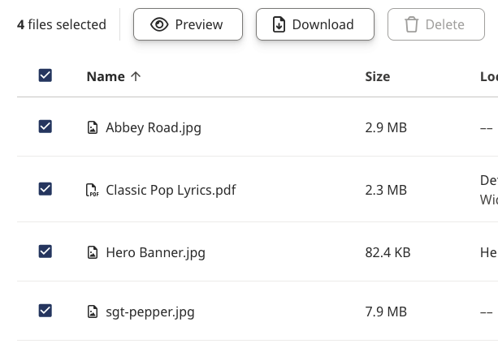

The **Engagement Files** tab in the admin view allows you to manage the files that are currently associated with a given engagement.

{: .light .shadow .rounded-10}

## Overview

After an administrator creates an engagement, administrators and assigned team members can manage the files for a given engagement. To navigate to the Files Tab, select an engagement from the admin area and click on the Files tab. You will be presented with a list of files associated with the engagement. 

**Counts:** Above the list of files, you can find a total file count and a count of files that are not in use (unlinked). 

**File table:** This area lists various data for the engagement's files:
- **Name:** The name of the file, initially based on the original upload file name. This can be changed at any time using Rename from the action menu.
- **Size:** The amount of space that the file occupies on disk, either in kilobytes or megabytes
- **Location:** When a file is unlinked, the value will be set to two dashes. If the file is currently linked, it will display where the file is being used.
    - **Widget:** For files linked to widgets, such as the image widget and the files widget, you will have a value like "(widget type) widget: (widget name)"
    - **Hero image:** The main image that is displayed in the background of your engagement
- **File type:** The type of a given file, sometimes referred to as the file MIME type. Common values include image/jpeg, image/png, and application/pdf.
- **Uploaded by:** The person who originally uploaded the file
- **Actions:** See the Single File Actions section

**Total used space:** At the bottom of the file list, you will see the total amount of storage space that the engagement's files are occupying. 

## Single File Actions

These are the file actions that can be used for a given file by clicking on the Select Action button.

**Preview:** Clicking on the preview button allows you to preview the content of the file. A pop-up window will appear with the title of the file, a download button, an area for displaying images, and additional file metadata at the bottom, including name, size, uploaded date, and uploader. If a PDF is being previewed instead of an image, the PDF will open in a separate browser tab.

**Download:** Pressing this button will download the file.

**Copy link:** Copy the URL of the file download to the clipboard.

**Rename:** Give the file a new name. A window will appear where you can input the new title.

**Replace PDF:** This special option is reserved for PDF files and will not be displayed on other file rows. It allows you to replace your current PDF file with a new file, while maintaining the existing URL. This is useful in situations where you have already provided a URL that cannot be broken, but you need change what PDF the user sees.

**Unlink:** Unlink this file from the engagement. For example, if it's a hero image, it will be removed from the hero section of your engagement. This action is not available when the engagement is already published. However, you can still replace images and files directly through the authoring section. Files can't be deleted until they have first been unlinked. You can check if a file is already unlinked in the Location column. If you see two dashes for the given file row, the file has been unlinked.

**Delete:** This removes the file from the file list. The action is not undoable and will make your file permanently inaccessible. You can't perform this action when the file is not yet unlinked. You will be given a confirmation window where you can confirm if you would like to delete the file. This is a safety measure to avoid accidental file removal.

## Group File Actions

In addition to single file actions, you can also modify several files at once. Do this by selecting the files via the checkboxes at the beginning of each row. Once one or more files are selected, three buttons will appear, replacing the existing file counts.

**Preview:** Preview multiple files (such as images) in the file preview pop-up window. You will see left and right arrows, allowing you to scroll through your list of selected files.

**Download:** Download the selected files.

**Delete:** Remove the selected files. This option will be disabled if any of the selected files are still linked. Remember that files must be unlinked before they are deleted. A confirmation window will be provided, so that you can confirm if you would like to remove the selected files. This action is not undoable.
