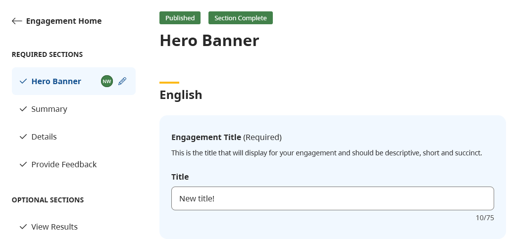
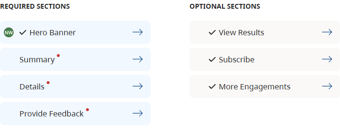
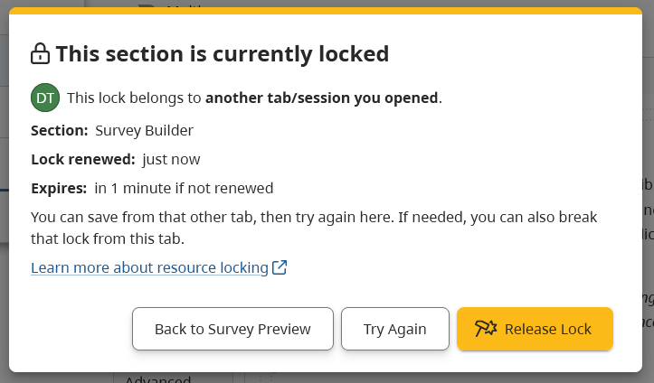
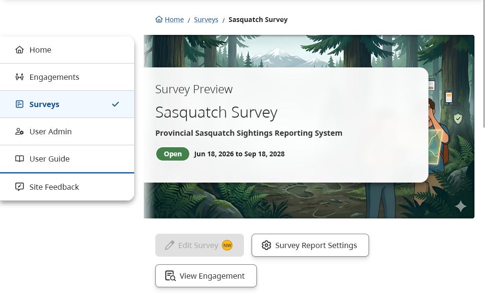
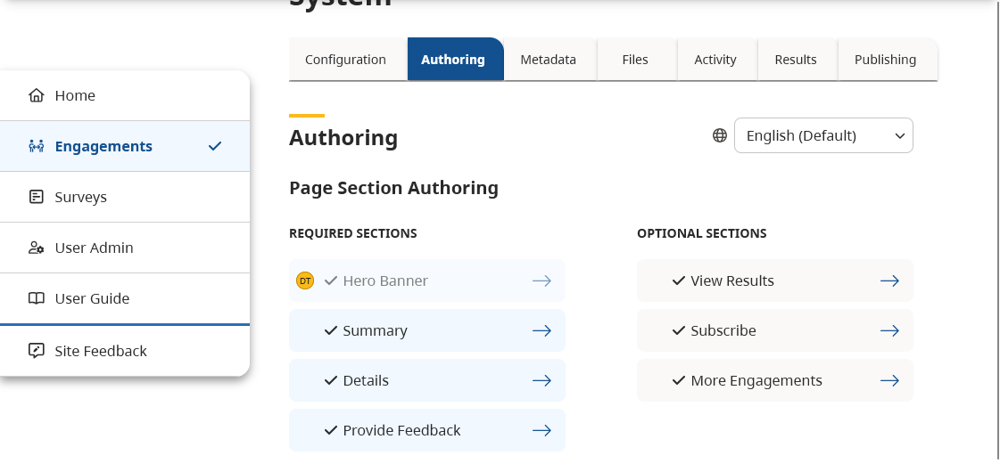
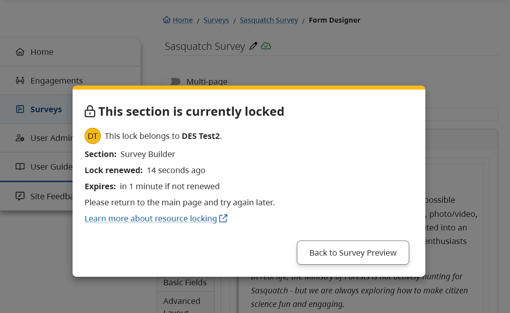
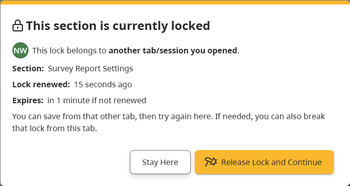
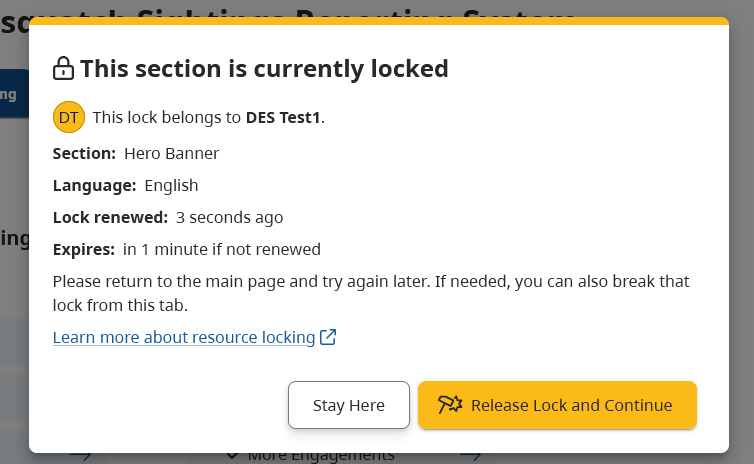

In DEP, certain types of resources are *locked* while being edited. Editing locks help prevent people from accidentally overwriting each other's changes. Locks are temporary and are released when editing is complete or after a timeout period.

## How Locking Works
If you are simply viewing an engagement or survey normally, you will not have a lock on it. A lock is acquired when you start editing a section. You can tell if you have a lock by the presence of a green bubble with your account's avatar next to the section name.

{: .light .shadow .rounded-10}
{: .light .shadow .rounded-10}
_The green indicator shows that the Hero Banner is locked by the current account._

## Locks Held by You

When a lock is held by you (green bubble) it indicates that you have exclusive editing rights for that section. Other users will see that the section is locked and will not be able to make changes until the lock is released.

If you try to visit a section that is locked by your account in another tab or on another device, you will see a message indicating that the section is already locked by you:

{: .light .shadow .rounded-10}

If you see this, you may wish to try to save the content that you have open on the other device or tab. If you're not sure where you've held the lock, or do not care about the changes from that session, you may also press "Release Lock" to take over editing that resource.

## Locks Held by Others

When a lock is held by another user, you will see a yellow bubble with their avatar next to the section name. This indicates that the section is currently being edited by someone else, and that you cannot make changes until the lock is released.

{: .light .shadow .rounded-10}
{: .light .shadow .rounded-10}
_The yellow indicator shows that the Hero Banner is locked by another user._

When trying to visit a section that is locked by another user, or if another user starts editing the section you are currently viewing, you will see a message indicating that the section is currently being edited by someone else. This helps prevent conflicting changes and ensures that only one user can edit a section at a time.

{: .light .shadow .rounded-10}
_The modal shows that the section is locked by another user._

If you see this modal, you can try to wait until the other user releases the lock, or coordinate with them to determine when it will be available. If necessary, an admin can also release the lock on your behalf.

## How locks are released

Locks are refreshed as long as an editing session holds them. An active session will keep renewing its lock, so it will not expire while it is being worked on. When you finish editing or leave the area, the lock is normally released; closing the tab will also release it in most cases. Because it auto-saves, a survey will remain locked briefly after the most recent change. If release fails or the session stops renewing, a lock normally expires about 90 seconds after its last renewal.

If you see a lock or save error, do not assume your changes were saved. Check the other session or contact the editor, then return to the area and try again after the lock is released. If the problem persists, contact your administrator.

For more information, see [Edit an Engagement](/posts/edit-an-engagement/), [Edit a Survey](/posts/edit-a-survey/), and [Internationalization and Language Switching](/posts/18n-language-switching/).

## Resolving a conflict

1. If another person owns the lock, return to the overview or previous page and ask them to save and finish editing. Then try again. You can work on a different available area in the meantime.
2. If the lock belongs to another tab or session you opened, save your work there first. Return to this tab and try again. When shown, **Try Again** checks the lock status.
3. If necessary, use **Release Lock** or **Release Lock and Continue** when the option is available. You can release your own lock; users with the required member-management permission can also release another person's lock.

> Releasing someone else's lock can interrupt their editing and put unsaved work at risk. Coordinate with them before releasing it. The same applies to work in your other tab.
{: .prompt-warning }

## Engagement-specific notes

On the **Authoring** tab, editing areas such as Hero Banner, Summary, Details, Provide Feedback, Subscribe, and More Engagements have separate locks. You can usually work in one area while someone else edits another.

Engagement locks are often be specific to the selected language, so different languages may be locked separately (For example, you could edit the Summary section in English while someone else edits it in French). Some structural changes affect all languages and require a lock for the whole section. If an area is unavailable, check the selected language and coordinate with the other editor.

The **Configuration** section has a separate lock that applies across all languages.

## Survey-specific notes

The **Survey Builder** and **Survey Report Settings** have separate locks for each survey, shared across languages. The builder requests a lock when you start making changes; the report settings page requests one when it opens. The builder automatically saves changes, so check for save errors before leaving.

{: .light .shadow .rounded-10}
_A Survey Report Settings lock held by another tab of the same account._

## Admins only: Releasing another user's lock

Administrators with the required member-management permission can release locks held by other users. This can be useful if a user has left an area without releasing their lock (or the lock is otherwise stuck), but it should be done with caution to avoid interrupting their work. Always coordinate with the user before forcibly releasing their lock whenever possible.

{: .light .shadow .rounded-10}
_An administrator can release another user's lock if necessary._